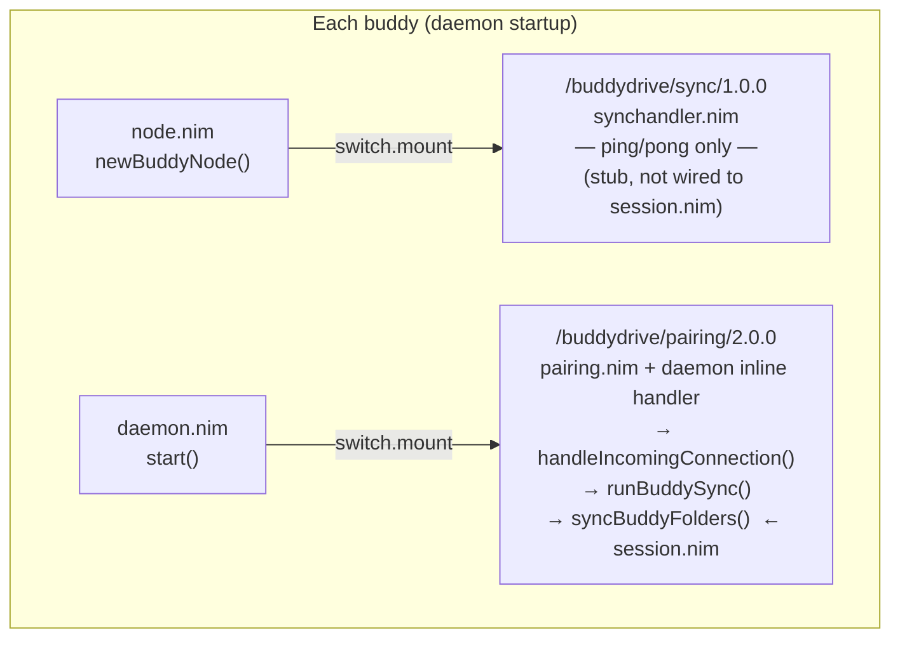
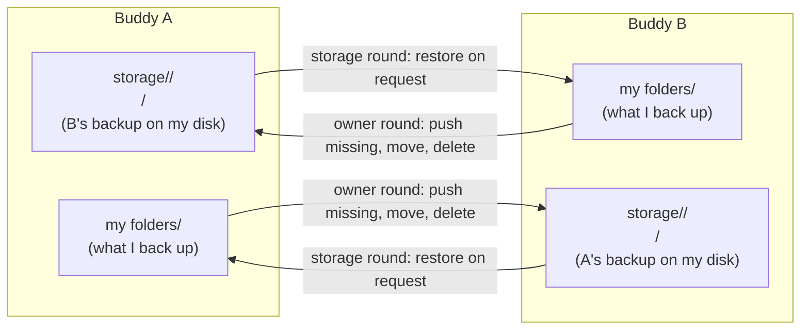

# BuddyDrive Architecture

How two buddies find each other, and what a sync session does once they do.
For the protocol invariants see [AGENTS.md](../AGENTS.md) and
[PLAN.md](PLAN.md); for usage see [MANUAL.md](MANUAL.md).

## Connection & Session Flow

```mermaid
sequenceDiagram
    participant API as Relay API<br/>api.buddydrive.org
    participant CG as Buddy A<br/>(no public addr)
    participant R as TCP Relay<br/>relay-eu.buddydrive.org:41722
    participant PB as Buddy B<br/>(public addr)

    Note over CG,PB: 1 · Discovery (publish 4h; lookup when the buddy's interval is due)
    Note over API: key = pairingCode + publishing buddy's own id
    CG->>API: PUT /discovery/<key(A)>  {addrs, reachable=false}<br/>X-HMAC + X-BD-Discovery-Token
    PB->>API: PUT /discovery/<key(B)>  {addrs, reachable=true}<br/>X-HMAC + X-BD-Discovery-Token
    CG->>API: GET /discovery/<key(B)>
    API-->>CG: B's peerId + public addrs + reachable=true

    Note over CG,PB: 2 · Connection (the side without a public address initiates)
    alt direct TCP reachable, or buddy-addresses configured
        CG->>PB: dial /buddydrive/pairing/2.0.0
    else no public address on either side
        CG->>R: connect, send pairing token
        PB->>R: connect, send pairing token
        Note over CG,R,PB: relay splices the two TCP streams
    end

    Note over CG,PB: 3 · Handshake (PairingProtocol, wire version 7)
    CG->>PB: performHandshake()
    PB-->>CG: acceptHandshake()

    Note over CG,PB: 4 · Session — runs INSIDE the connection handler<br/>(libp2p closes a stream as soon as its handler returns)

    par exchange owner folder lists
        CG->>PB: sendOwnerLists (my folders + file metadata)
    and
        PB->>CG: sendOwnerLists (my folders + file metadata)
    end

    Note over CG,PB: whom to serve first = lower buddy UUID (strictly alternating)

    loop owner round (my folders → their storage)
        CG->>PB: msgMoveFile / msgFileDelete / request + push chunks
        PB-->>CG: msgFileAck
    end
    loop storage round (their folders → my storage)
        PB->>CG: msgMoveFile / msgFileDelete / request + push chunks
        CG-->>PB: msgFileAck
    end

    Note over CG,PB: a folder owned by another machine is answered with<br/>msgFolderRefused instead of being overwritten

    Note over CG,PB: 5 · Session end in a fixed order
    CG->>PB: msgSessionEnd
    PB-->>CG: msgSessionEnd
    Note over CG,PB: responder waits for the initiator to hang up, so a relay<br/>cannot truncate a stream that still has bytes in flight

    Note over CG,PB: 6 · The connection carries one session and is dropped.<br/>The next dial is scheduled by the buddy's interval and window
```

## Protocol Mounting



## Storage Layout (backup, not mirror)



An encrypted folder's directory holds `.blob` files (sealed chunk frames stored
exactly as the owner sent them) and `.meta` sidecars. Blob names are a hash of
the encrypted path. Unencrypted folders are stored as ordinary files.

Because each buddy's folders land under their own buddy id, two folders both
named `docs` never collide — and because each folder lands under its *folder
id*, renaming a folder does not orphan its backup.

## Who Decides What

| Action | Decided by | The other side |
|--------|-----------|----------------|
| Add / modify a file | Owner | Stores the sealed chunks |
| Rename a file | Owner (`msgMoveFile`) | Moves the blob, does not infer from ciphertext |
| Delete a file | Owner (`msgFileDelete`) | Removes the blob |
| Restore a missing file | Owner requests | Serves the sealed chunks |
| Append-only guard | Owner | Never overwrites an existing local file |
| Which machine owns a folder | The first machine to back it up | Answers `msgFolderRefused` to any other machine with the same identity, until `recover`/`takeover` claims it |
| When to start a sync | Each side, from its own buddy interval and window | Always accepts an incoming connection from a known buddy |
